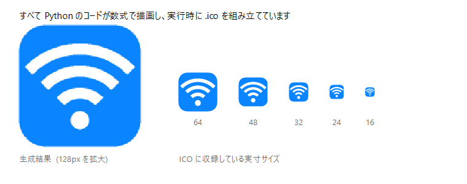

# wifiscan

Windows 用の Wi-Fi スキャナ。周囲のアクセスポイントを **チャネル使用率と接続端末数つき** で一覧表示します。
Python 標準ライブラリだけで動き、`wlanapi.dll` を ctypes で直接叩きます。

> A Wi-Fi scanner for Windows that shows channel utilization and station count per BSS.
> Pure stdlib Python + tkinter, calling `wlanapi.dll` through ctypes. No third-party dependencies.


<sub>※ 上の画像は実際の画面を模した SVG です。SSID・BSSID はすべて架空のものに置き換えています。</sub>

## なぜ作ったか

`netsh wlan show networks` には、2 つの困った性質があります。

**1. スキャンを実行しない**

netsh はドライバの BSS キャッシュを読むだけです。Windows は接続中にほとんど自発的スキャンをしないため、
キャッシュが痩せて **接続中の 1 件しか返ってこない** ことがあります。Wi-Fi 一覧を開いた直後なら 20 件返るのに、
しばらくすると 1 件になる、という挙動の原因がこれです。

本ツールは `WlanScan()` を明示的に呼んでからビーコンを読むので、常に現在の状態が出ます。

**2. チャネル使用率が読みにくい**

電波が強いのに遅い、という状況の原因はたいてい **チャネルの混雑** です。netsh も BSS Load 自体は出しますが、
`207 (81 %)` のような生値まじりのローカライズされたテキストで、他の情報と並べて比較するのが面倒です。

本ツールは BSS Load 要素を構造体から直接読み、使用率で色分けして表示します。

## 機能

| 機能 | 内容 |
|---|---|
| スキャン | `WlanScan` を実行してから取得。別スレッドなので UI が固まりません |
| 自動更新 | 10〜600 秒間隔 |
| チャネル使用率 | BSS Load 要素から取得し、40% 未満=緑 / 40〜70%=黄 / 70% 以上=赤 で色分け |
| 接続端末数 | BSS Load 要素から取得 |
| RSSI | dBm の生値。netsh の丸められた % より細かく見えます |
| 接続中の強調 | 現在接続している BSSID を太字表示 |
| ステータス行 | 接続中の SSID・BSSID・PHY・受信/送信 Mbps・電波強度 |
| 列ソート | ヘッダクリックで並べ替え |
| ヘッダのツールチップ | 各列の意味と読み方を表示 |
| 2.4GHz の切り替え | ドライバ設定を UI から変更（管理者権限が必要） |
| クリップボードにコピー | 表全体を TSV で。AI に貼って相談しやすい形式です |
| ログ | タイムスタンプつきの操作ログ |


## 動作要件

- Windows 10 1703 以降（DPI 対応に `SetProcessDpiAwarenessContext` を使用）
- tkinter 入りの Python 3.8 以降
- 無線 LAN アダプタ

**サードパーティ製ライブラリは不要です。** Pillow も pywin32 も使いません。

## 使い方

```
pythonw.exe wifiscan.pyw
```

`.pyw` なのでコンソールウィンドウは出ません。

> **注意:** Microsoft Store 版 Python のエイリアス（`%LOCALAPPDATA%\Microsoft\WindowsApps\pythonw.exe`）は
> 実体のないスタブのことがあります。その場合は python.org 版か、[uv](https://github.com/astral-sh/uv) が
> 管理する Python を使ってください。
>
> ```
> %APPDATA%\uv\python\cpython-3.12.*-windows-x86_64-none\pythonw.exe
> ```

ダブルクリックで起動したい場合は、`.pyw` を上記 `pythonw.exe` に関連付けてください。
`.pyw` の関連付けは Python インストーラを使っていない環境では未設定のことがあります。

## 列の意味

| 列 | 内容 |
|---|---|
| SSID | ネットワーク名。伏せている AP は `(非公開)` |
| BSSID | AP の無線ごとの MAC アドレス。同じ SSID でもバンドごとに別の行になります |
| BAND | 2.4GHz / 5GHz / 6GHz。中心周波数から算出 |
| CH | チャネル番号。中心周波数から算出 |
| PHY | 11a/b/g/n/ac/ax/be |
| SIGNAL | 信号品質 0〜100%。Windows が RSSI から算出した値 |
| RSSI | 受信信号強度 (dBm)。-50 前後で非常に良好、-80 以下は速度が出にくい |
| STA | その BSSID に接続しているクライアント台数 |
| UTIL | チャネル使用率 |

### UTIL の読み方

AP がそのチャネルを「使用中」と判定した時間の割合です。規格上の定義は
「物理または仮想キャリアセンスで媒体がビジーと判定された時間の割合を 255 に正規化した値」で、
**自分のネットワーク以外の電波も含みます。**

そのため次のようなことが起こります。

- **STA が 0 でも UTIL が高い** — 同じチャネルを使う近隣の AP が混んでいる
- **STA が多くても UTIL が低い** — 台数は多いが、ほとんど通信していない

| UTIL | 状態 |
|---|---|
| 〜30% | 余裕あり |
| 30〜50% | やや混雑 |
| 50〜70% | 競合発生。遅延がばらつく |
| 70%〜 | 飽和。リンク速度が高くても実効速度が出ない |

`STA` と `UTIL` は AP が広告する **BSS Load 要素（Element ID 11）** から取得しています。
この要素はオプションなので、広告していない AP では `-` になります。家庭用ルーターでは省略されがちです。

また、どちらも AP の自己申告値で、直近のビーコン区間の測定値です。瞬間的に振れるため、
1 回の値で判断せず数回見ることをおすすめします。

## 2.4GHz の切り替えについて

ツールバーの `2.4GHz を無効化` / `2.4GHz を有効化` は、ドライバの `WirelessMode` を書き換えます。

- `17` … 5GHz のみ (802.11a)
- `34` … デュアルバンド (802.11a/b/g)

2.4GHz が混雑しているときに、クライアントを強制的に 5GHz へ寄せる用途を想定しています。
Intel のドライバには「優先バンド」設定もありますが、あれは助言レベルで、2.4GHz のほうが電波が強いと
そちらが選ばれ続けます。`WirelessMode` なら物理的に選べなくなります。

**注意点:**

- 変更には管理者権限が必要です。ボタンを押すと UAC の確認が出ます
- アダプタが再起動するため、Wi-Fi が一瞬切断されます
- 無効化すると **2.4GHz 専用の SSID には接続できなくなります**（自宅のルーター、ゲスト用 SSID など）
- `WirelessMode` は Intel 系ドライバのプロパティです。持たないアダプタでは `2.4GHz: 不明` と表示され、
  ボタンは無効になります

状態の読み取りはレジストリを直接見るだけなので、管理者権限は不要です。

## 仕組み

使用している Windows API は 5 つです。

| API | 役割 |
|---|---|
| `WlanOpenHandle` | ハンドル取得 |
| `WlanEnumInterfaces` | インターフェース GUID の取得 |
| `WlanScan` | **スキャンの実行**（netsh にないのがこれ） |
| `WlanGetNetworkBssList` | BSS 一覧を `WLAN_BSS_ENTRY` 構造体で取得 |
| `WlanQueryInterface` | 現在の接続情報（BSSID、送受信レート）を取得 |

netsh のローカライズされたテキストをパースしないので、文字コードや表記ゆれの影響を受けません
（netsh の日本語出力は「チャネル」と「チャンネル」が混在しており、リダイレクトの有無で UTF-8 と CP932 が変わります）。

その他の実装メモ:

- **アイコン** — 画像ファイルを持たず、Python のコードが描いて `.ico` を組み立てます。
  詳細は [アイコンもソースの中で作っています](#アイコンもソースの中で作っています) を参照
- **DPI** — `SetProcessDpiAwarenessContext(PerMonitorV2)` を `Tk()` の生成前に呼び、
  `tk scaling` とピクセル指定値を実 DPI に合わせます。これをしないと高 DPI 環境で文字がぼやけます
- **タスクバー** — `SetCurrentProcessExplicitAppUserModelID` を設定しないと、
  `pythonw.exe` として他の Python アプリとまとめられ、アイコンが反映されません

## アイコンもソースの中で作っています

このリポジトリに **アイコンの画像ファイルは入っていません**（`docs/` の説明用画像を除く）。
ウィンドウとタスクバーに出る Wi-Fi アイコンは、`wifiscan.pyw` のコードが起動時に描いて
`.ico` を組み立てたものです。



配布物を `.pyw` 1 ファイルに保てること、そのために Pillow を足したくなかったことが理由です。
やっていることは 3 段階です。

### 1. ピクセルを数式で塗る

円弧は「中心からの距離が半径 ± 線幅の半分」かつ「垂直からの角度が ±46 度以内」の領域、
という判定で描きます。パスを引くのではなく、ピクセルごとに内外を判定します。

```python
def in_fg(px, py):
    dx, dy = px - cx, py - cy
    d = math.hypot(dx, dy)
    if d <= dot:                                        # 中心のドット
        return True
    if dy > 0:                                          # 下半分は描かない
        return False
    if abs(math.degrees(math.atan2(dx, -dy))) > 46.0:   # 扇形の範囲
        return False
    return any(abs(d - r) <= half for r in radii)       # 3 本の円弧
```

このままでは輪郭がジャギーになるので、1 ピクセルを格子状に分割して内側に入った割合を
そのままアルファ値にします。いわゆるスーパーサンプリングです。

```python
def cover(fn, x, y):
    hit = 0
    for i in range(n):
        for j in range(n):
            if fn(x + (i + 0.5) / n, y + (j + 0.5) / n):
                hit += 1
    return hit / (n * n)
```

分割数 `n` は 64px 以下で 3、それより大きいサイズでは 2 にしています。256px を 3×3 で
処理すると純 Python では体感できるほど遅くなるためです。

背景の角丸四角も同じ枠組みで、角の中心からの距離で判定しています。前景と背景それぞれの
被覆率を求めてから色を混ぜるので、白い電波マークの縁も背景の青に対して滑らかに繋がります。

### 2. DIB にする（PNG ではなく）

ICO は Vista 以降 PNG 圧縮されたエントリを埋め込めるので、最初はそれで実装しました。
ところが **GDI+ が読めず** `Icon.ToBitmap()` が `ArgumentOutOfRangeException` を投げます。
ICO 内 PNG は読み手によって対応が割れるため、無圧縮の DIB に変更しました。

```python
# BITMAPINFOHEADER。高さは XOR + AND マスク分で 2 倍にする決まり。
hdr = struct.pack("<IiiHHIIiiII", 40, size, size * 2, 1, 32, 0, 0, 0, 0, 0, 0)
```

DIB の行は **下から上** の順で、色は **BGRA** 並びです。32bit でアルファを持つので
AND マスクは全 0 で構いません。ファイルは 370KB ほどになりますが、生成は初回だけです。

### 3. ICO コンテナに詰める

ヘッダに続いて 16 バイトのエントリが並び、その後ろに各サイズの実データが入ります。

```python
b = 0 if size >= 256 else size      # 256 は 0 で表す
entries += struct.pack("<BBBBHHII", b, b, 0, 0, 1, 32, len(data), offset)
```

幅と高さが 1 バイトしかないため、256px は 0 と書く決まりになっています。
収録サイズは 16 / 24 / 32 / 48 / 64 / 128 / 256 で、タイトルバー（16px）、Alt+Tab（32px）、
高 DPI のタスクバー（40〜64px）、エクスプローラーの大アイコン（256px）をカバーします。

### 生成とキャッシュ

```python
path = os.path.join(base, "wifiscan", "wifiscan.ico")
if os.path.exists(path) and os.path.getsize(path) > 0:
    return path
```

`%LOCALAPPDATA%\wifiscan\wifiscan.ico` に置き、2 回目以降は再利用します。生成は約 1 秒です。
スクリプトと同じ場所には書きません。デスクトップに置いて使うことを想定しているためです。

ウィンドウ表示後に `after(50, ...)` で走らせるので、起動そのものは待たされません。

なお、タスクバーに反映させるにはこれが必要です。

```python
C.windll.shell32.SetCurrentProcessExplicitAppUserModelID("wifiscan.tk.app")
```

設定しないと `pythonw.exe` として他の Python アプリと同じグループにまとめられ、
こちらのアイコンが使われません。

## 既知の制限

- Windows 専用です
- チャネル幅（20/40/80/160MHz）は表示しません。HT/VHT/HE Operation IE のパースが必要なため
- `WlanScan` は非同期で完了通知が返りますが、本ツールは簡略化のため固定 5 秒待っています
- 6GHz のチャネル番号は `(中心周波数MHz - 5950) / 5` で算出しています

## ライセンス

MIT License. 詳細は [LICENSE](LICENSE) を参照してください。
